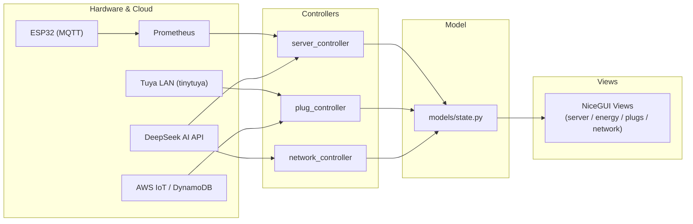

# 🖥️ Homelab Server Dashboard

A real-time monitoring and control system for a self-hosted home server. Built with a clean **MVC architecture** in Python, it provides a unified live view of hardware health, IoT sensor data, smart plug power consumption, network diagnostics, and AI-generated SRE insights — all in a responsive, glassmorphism web UI.

---

## ✨ Features

### 🖥️ Server Monitor
- Live **CPU, Memory, NVMe & HDD** metrics via Prometheus
- **CPU & NVMe temperatures** via `/sys/class/thermal/` and `smartctl`
- **IoT Environmental Sensors** — ESP32 temperature & humidity over MQTT
- **AI SRE Analysis** — DeepSeek-powered health summary, cached and refreshed every 30 minutes

### ⚡ Energy Monitor
- Real-time **wattage, voltage, and current** per smart plug
- **Daily / Weekly / Monthly** energy history charts
- **Estimated cost** calculated using TNB Domestic General tariffs with shared monthly usage allocation

### 🔌 Smart Plugs (Tuya Local LAN)
- Direct **LAN polling** via `tinytuya` — no Tuya cloud dependency
- Toggle power states with a **double-confirm safety prompt** for critical plugs
- Per-plug **live wattage history chart** and fleet overview

### 🌐 Network Monitor
- **Ping probes** to Google DNS, Fast.com, and YouTube — latency, jitter, packet loss
- **Traceroute** on anomaly detection with route-change alerts
- **AI Network Diagnosis** — DeepSeek analyses probe data and identifies internal vs external issues
- **Telegram alerts** on anomaly detection

### ☁️ Cloud Monitor (`/cloud`)
- Mirrors energy readings stored in **AWS DynamoDB**
- Per-device today's summary + last 15 readings table

---

## Ports page and service controls

The production navbar includes **Ports** after **Network**. It reads the dashboard
host's TCP/UDP bindings using `ss -H -tulpn`, with search, protocol filtering and a
manual refresh. Status refreshes every 15 seconds. It monitors the machine running
`app.py`; it does not scan a remote host from the design preview.

Install the Linux `iproute2` package if `ss` is missing. Process names/PIDs are only
shown when the dashboard user has permission to inspect them.

### JSON parsing errors on the Ports page

`Expecting value: line 2 column 1` means a JSON input was unreadable, not that
socket discovery found no ports. Two inputs were parsed: `port_services.json`
and PM2 `jlist` output. PM2 may print daemon startup notices before its JSON.
The PM2 parser now accepts those notices and ANSI color prefixes. Invalid service
configuration reports its filename and line/column. Neither malformed configuration
nor an individual manager response now removes the live socket inventory; affected
controls stay read-only and the page shows the specific error. Reload the deployed
code and restart the dashboard to use this fix.

### Enable Start / Stop

1. Copy `port_services.example.json` to `port_services.json` and edit it to match
   services on your server. Supported managers: `systemd`, `docker`, `pm2`. Map
   each service's target and all its TCP/UDP ports. Docker targets must be container
   names, not `docker-proxy` PIDs; PM2 targets must already exist in that user's PM2.
2. Set a strong `PORT_CONTROL_TOKEN` in the dashboard environment. Optionally set
   `PORT_SERVICES_FILE` to the absolute path of the configuration file.
3. Restart the dashboard. Enter the token in the Ports page to authorize commands.

Unconfigured ports remain read-only. Configured stopped services stay listed, so
Start remains available. Both actions require confirmation and affect the entire
service, including its other ports. Start is rejected when a configured port is
already occupied while the service is stopped. Actual service-manager state is
checked after each command; an unconfirmed state is shown as an error.

The dashboard account must already have permission to manage the configured
services. Commands run as that account, without interactive sudo or shell commands.
This change does not grant system permissions. PM2 uses the dashboard account's
process list. Docker needs access to the relevant daemon. For systemd, use scoped
host permissions for the specific units rather than running the dashboard as root.
The token is not persisted in browser storage. Use the controls through a trusted,
protected connection. Stopping the `homelab-dashboard` manager entry is blocked.

The JSON file is an administrator-controlled allowlist; UI events cannot supply
arbitrary commands, service targets or PIDs. Stop/Start operate only on configured
targets. Live Orange Pi service commands were not exercised during local testing.

Validation:

```bash
python3 -m unittest test_port_manager test_switch_response test_tnb_tariff -v
```

---

## Recent fixes (9 October 2026)

### Live power works, but today's energy and cost stay zero

The AWS publisher used `datetime.now(timezone.utc)` without importing `datetime`
and `timezone`. With AWS enabled, this could raise before the local database
insert because publishing and storage shared one error handler. Watts updated
from the plug status even though energy readings were never stored.

The imports are fixed. Local inserts now happen before optional publishing, and
DB aggregation, AWS and MQTT have separate error handlers. Database/network I/O
also runs outside the shared plug-state lock. Today's cache is updated before
monthly-summary maintenance, so a monthly failure cannot discard today's totals.
Current-month energy is read directly from raw records instead of using the latest
stored month, which could be from an earlier month.

Restart the dashboard after installing the fix. The first poll stores zero interval
energy; subsequent successful polls accumulate Wh from watts and elapsed time.
If totals remain zero, inspect dashboard logs for `[db] insert error` and
`[energy_cache]` messages. Cloud errors use `[aws]` and cannot block local inserts.
Also check the server clock/timezone and whether today's records exist in
`plug_energy`. Live Orange Pi logs were not available during diagnosis, so the
missing-import bug is confirmed in code but not confirmed as the deployed failure.
Historical missing readings are not reconstructed by this fix.

Regression checks: `python3 -m unittest test_energy_pipeline -v`.

### Switch response delay

**Problem:** The switch handler waited for both the plug command and the database
log write before updating the UI. A slow database could therefore leave the button
showing the old state even after the physical plug had switched. The button also
allowed repeated clicks while a command was still running.

**Solution:** In `controllers/plug_controller.py`, `toggle_plug()` now returns after
the plug acknowledges the command and updates the cached switch state. It schedules
`_log_switch_change()` as a background task instead of awaiting the database write.
Tasks are retained until completion, and logging errors are reported in server logs
without changing a successful device command into a failed command.

In `views/plugs_view.py`, `_toggle_with_pending()` disables the device button and
shows a loading indicator while the command runs. It restores the button in a
`finally` block, including when a command fails. Periodic refreshes leave the pending
button's label and styling alone. Existing critical-device confirmation remains.

**Result:** Database latency no longer blocks the switch response. This does not
remove LAN connection latency: commands still open a fresh Tuya connection with the
existing timeout and retry settings. Live hardware response times have not been
measured. Background logs are best effort; an abrupt shutdown can interrupt a write.
Restart the dashboard process to load the changes.

### TNB residential charge calculation

**Problem:** The dashboard used old Tariff A rates, applied monthly brackets to
individual device/day totals, and used a hardcoded RM0.218/kWh in the design preview
chart. This could produce inconsistent estimates and repeat monthly charges when
adding up device costs.

**Solution:** `services/tnb_tariff.py` provides one Domestic General calculator used
by the database services and design preview. It includes energy, capacity, network,
efficiency incentives, retail charge, AFA, service tax and KWTBB. Device/day costs
are allocated proportionally from a shared monitored calendar-month total. Production
charts group readings by their actual month before calculating cost.

The October 2026 AFA is +3.61 sen/kWh. The temporary 800 kWh protection applies for
September–December 2026. Rates were checked against [TNB's tariff calculator](https://www.mytnb.com.my/tariff)
and its published calculator code on 9 October 2026. Future AFA forecasts are excluded;
update the local AFA table after each official publication. Missing AFA for a chargeable
month raises an error rather than silently reusing an old rate.

**Result and limits:** Costs are estimates for monitored loads, not the full household
bill. Unmonitored appliances, overlapping plug measurements, actual meter-cycle dates,
minimum charges, special rebates, NEM/ToU and September adjustment credits can change
the real bill. Raw monthly energy records must remain available for the allocation
basis. See [TNB_TARIFF.md](TNB_TARIFF.md) for calculation scope and maintenance details.

### Validation

Eight automated tests passed: three switch-response tests and five tariff tests.
The switch tests cover slow database logging, failed device commands, and logging
failures after successful commands. Tariff checks cover bracket boundaries, shared
allocation, month grouping, invalid inputs and unpublished AFA. Another 23 October
usage cases matched TNB's official calculator. Python compilation and `git diff --check`
also passed.

Run the automated checks from the project root:

```bash
python3 -m unittest test_switch_response test_tnb_tariff -v
```

---

## 🏗️ Architecture

The project follows a strict **MVC (Model-View-Controller)** pattern:

```
Server_Dashboard/
├── app.py                        ← Entry point — wires MVC layers & starts background tasks
│
├── models/
│   └── state.py                  ← Single source of truth (all shared mutable state + constants)
│
├── controllers/
│   ├── server_controller.py      ← Prometheus metrics, AI insights, MQTT publisher
│   ├── plug_controller.py        ← Tuya polling loop, energy cache, toggle commands
│   └── network_controller.py     ← Ping probes, traceroute, AI network diagnosis, Telegram alerts
│
├── views/
│   ├── layout.py                 ← Routes: @ui.page('/') and @ui.page('/cloud')
│   ├── server_view.py            ← Server tab UI
│   ├── energy_view.py            ← Energy tab UI
│   ├── plugs_view.py             ← Plugs tab UI
│   ├── network_view.py           ← Network tab UI
│   └── styles.py                 ← Shared CSS (glassmorphism, dark mode tokens)
│
├── services/
│   ├── db.py                     ← MariaDB queries (energy telemetry, state changes)
│   ├── tnb_tariff.py             ← Shared TNB Domestic General monthly cost calculator
│   ├── tuya_local.py             ← tinytuya device config & LAN helpers
│   ├── aws_iot_publisher.py      ← AWS IoT Core / DynamoDB publisher
│   └── cloud_db.py               ← DynamoDB read queries for /cloud page
│
└── backend/
    ├── ai_agent.py               ← DeepSeek AI agent: collects live metrics, generates SRE report
    └── telegram_bot.py           ← Telegram bot: /status and /top commands via ai_agent
```

### Data Flow



---

## 🛠️ Tech Stack

| Layer | Technology |
|---|---|
| **UI Framework** | [NiceGUI](https://nicegui.io/) (Python reactive UI) |
| **Metrics** | Prometheus + Node Exporter |
| **IoT Sensors** | ESP32 → MQTT → Prometheus |
| **Smart Plugs** | Tuya Local LAN (`tinytuya`) |
| **Database** | MariaDB (energy telemetry) |
| **Cloud DB** | AWS DynamoDB |
| **AI Agent** | DeepSeek API (`deepseek-chat`) |
| **Notifications** | Telegram Bot API |
| **Process Manager** | PM2 (`ecosystem.config.js`) |
| **Deployment** | Kubernetes Helm Chart (`/helm`) |

---

## 🚀 Setup & Running

### 1. Environment Variables
Create a `.env` file in the project root. **Do not commit this file.**

```env
# DeepSeek AI
DEEPSEEK_API_KEY=your_deepseek_api_key

# Telegram Alerts
TELEGRAM_BOT_TOKEN=your_telegram_bot_token
TELEGRAM_CHAT_ID=your_chat_id

# Optional: override AI cache file locations (defaults to project root)
AI_CACHE_PATH=/path/to/gemini_cache.txt
NETWORK_AI_CACHE_PATH=/path/to/gemini_network_cache.txt

# Optional: override plug poll interval in seconds (default: 10)
PLUG_POLL_INTERVAL=10
```

### 2. Install Dependencies
```bash
python3 -m venv venv
source venv/bin/activate
pip install -r requirements.txt
```

Key dependencies: `nicegui`, `tinytuya`, `mysql-connector-python`, `prometheus-api-client`, `python-telegram-bot`, `requests`

### 3. Run with PM2
```bash
pm2 start ecosystem.config.js

pm2 logs              # Live logs
pm2 status            # Process health
pm2 restart all       # Restart all services
```

The dashboard runs on **port 3000** by default (override with `PORT=` env var).

### 4. Run Locally (dev)
```bash
python3 app.py
```

---

## 🤖 AI Agent

`backend/ai_agent.py` is the core AI agent. It:
1. Collects live system metrics (CPU %, RAM %, CPU temp, top processes)
2. Sends a structured prompt to the **DeepSeek API**
3. Receives a 4-line SRE-style health summary
4. Caches the result to disk so the dashboard can display it without re-running the LLM

The **Telegram bot** (`backend/telegram_bot.py`) exposes this agent via `/status` and `/top` commands.

---

## 📡 Background Processes (PM2)

| Process | Script | Role |
|---|---|---|
| `homelab-dashboard` | `app.py` | Main NiceGUI web server |
| `mqtt-exporter` | `mqtt/mqtt_exporter.py` | Bridges ESP32 MQTT → Prometheus |
| `homelab-bot` | `backend/telegram_bot.py` | Telegram bot for remote queries |
